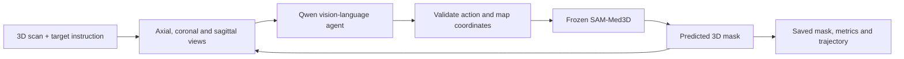

# MedSAM-Agent3D

**Language-guided, iterative segmentation of 3D medical images.**

This project explores whether a vision-language agent can turn an instruction such as "segment the liver" into a 3D segmentation by inspecting medical image slices, placing prompts, and refining a mask over multiple turns. It connects a Qwen vision-language model to a frozen SAM-Med3D segmentation model.

The implementation includes slice rendering, validated tool calls, mapping from displayed image coordinates to volume coordinates, iterative mask refinement, and evaluation with saved trajectories. It builds on the agentic segmentation approach in MedSAM-Agent and the pretrained segmentation model from SAM-Med3D, credited below.

## How it works



The agent can inspect another slice intersection, add positive or negative prompts, and stop. Ground-truth masks are optional during inference and are used for scoring rather than choosing the agent's prompts. A separate checkpoint smoke test uses a reference-derived prompt to check the SAM integration.

## Evaluation status

The existing experiment notes report **Dice 0.857 and IoU 0.750** on one left-femur case using the four-bit Qwen3.8-27B Colab pipeline. This is a single development result, not an estimate of performance across patients or organs.

The notebook also defines a reproducible development suite: two additional test-split scans, six structures per scan, and 12 scan/target pairs. Aggregate results for that suite are not reported here. See [evaluation details and limitations](docs/EVALUATION.md).

## Try the project

Use **Python 3.11** and run commands from the repository root. Downloaded scan volumes and model weights are excluded from Git.

```bash
git clone --recurse-submodules https://github.com/xiaod83/MedSAM-Agent3D.git
cd MedSAM-Agent3D
python -m venv .venv
```

Activate the environment with `source .venv/bin/activate` on Linux/macOS or `.\.venv\Scripts\Activate.ps1` in Windows PowerShell.

For an initial software check without installing ML dependencies:

```bash
python run.py --help
python run.py test --light
```

For a CPU development environment and the full regression checks:

```bash
python run.py setup --mode cpu
python run.py doctor
```

Full model inference needs readable SAM weights, a compatible model environment, and sufficient compute. Place SAM weights at `checkpoints/sam_med3d_turbo.pth`; see [checkpoint setup](checkpoints/README.md). The [Colab notebook guide](notebooks/README.md) describes the GPU workflow and its separate dependency profile.

```bash
python run.py single --volume scan.nii.gz --target liver
```

Add `--mask reference.nii.gz` to score a prediction. Use `python run.py single --help` for model and device options.

## Explore the code

| Location | Purpose |
|---|---|
| [`medsam_agent3d/loop.py`](medsam_agent3d/loop.py) | Agent actions, feedback, refinement and termination |
| [`medsam_agent3d/views.py`](medsam_agent3d/views.py) | Mapping between image panels and volume coordinates |
| [`medsam_agent3d/sam.py`](medsam_agent3d/sam.py) | SAM-Med3D integration and volume geometry |
| [`medsam_agent3d/agent.py`](medsam_agent3d/agent.py) | Vision-language model integration |
| [`tests/`](tests/) | Regression tests and mock pipeline checks |
| [`notebooks/`](notebooks/) | Colab experiment and configuration |
| [`docs/DEVELOPMENT.md`](docs/DEVELOPMENT.md) | Developer setup, commands and repository layout |

`run.py` is the shared command entry point. Run `python run.py --help` to see the available commands.

## Acknowledgments

- **SAM-Med3D:** pretrained 3D segmentation model and upstream implementation, maintained by [uni-medical](https://github.com/uni-medical/SAM-Med3D).
- **MedSAM-Agent:** reference approach for tool-based, iterative medical image segmentation, maintained by [CUHK-AIM-Group](https://github.com/CUHK-AIM-Group/MedSAM-Agent).
- **Qwen:** the vision-language model used to select actions.
- **TotalSegmentator:** the scan and organ-mask dataset used by the development workflow.

Upstream code, weights and data retain their respective licenses and terms.
